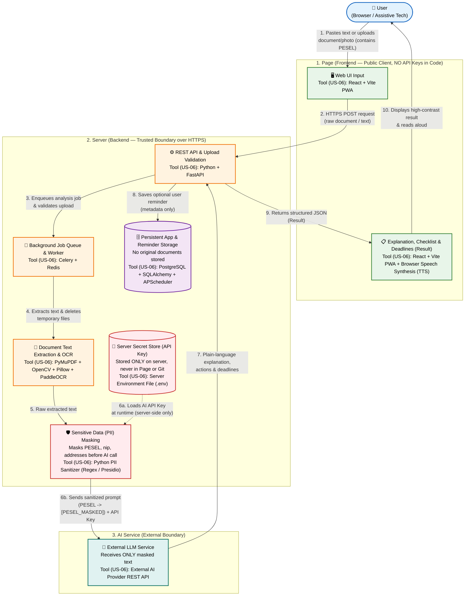

# System Architecture Plan (US-03)

## Overview

This document defines the system architecture and data flow for **ProsteFakty** (`user → page → server → AI → result`). Every component in the diagram maps directly to the tools selected in **US-06**, showing where sensitive personal data (such as PESEL numbers) is masked and where external API keys are stored.

## Architecture & Data Flow Diagram

## US-03 Checklist Verification

### 1. Flow: `user → page → server → AI → result`
1. **User:** Uploads an official letter/PDF or pastes text containing sensitive data.
2. **Page (`React + Vite PWA`):** Sends the input over HTTPS to the backend API without performing any direct calls to the AI provider.
3. **Server (`Python + FastAPI`, `Celery + Redis`):** Validates the upload, extracts text via `PyMuPDF` (digital PDFs) or `OpenCV + Pillow + PaddleOCR` (scans/photos), and immediately deletes temporary files.
4. **AI (`External AI Provider API`):** Processes the sanitized text and returns a plain-language explanation, relevant source passages, action items, and deadlines.
5. **Result (`React + Vite PWA` + `Browser Speech Synthesis`):** Renders the explanation in an accessible, high-contrast view with text-to-speech support, while optional deadline reminders are persisted via `PostgreSQL + SQLAlchemy + APScheduler`.

### 2. Sensitive Data Masking (e.g., PESEL) Before Going to AI
* **Where it happens:** Strictly inside the **Backend Server (`Python + FastAPI / Celery Worker`)**, immediately after text extraction (`PyMuPDF` / `PaddleOCR`) and **before** any outbound HTTP request leaves the server for the external AI API.
* **How it works:** The Python PII Sanitizer module scans the extracted text for Polish sensitive identifiers (such as 11-digit **PESEL** numbers, document IDs, bank account numbers, or phone numbers) and replaces them with placeholders (e.g., `03271212345` → `[PESEL_REDACTED]`).
* **Data hygiene:** Raw document files are deleted immediately after processing, and neither raw text nor OCR output is written to application or CI/CD logs.

### 3. API Key Storage (Not in the Page Code)
* **Where it is stored:** In a protected **server-side environment file (`.env`)** on the deployment host (and managed via `GitHub Secrets` only for deployment SSH access, as defined in `docs/tech-stack/ci-cd.md`).
* **Why it is safe:** The `React + Vite PWA` frontend never contains, fetches, or sees the AI API key in its source bundle, network tab, or browser storage. The backend (`FastAPI` / `Celery`) reads the key from the server's environment variables at runtime when calling the AI provider.

### 4. Mapping to Tools from US-06

| Architecture Box | Tool from US-06 | Role in the Flow |
| :--- | :--- | :--- |
| **Page (Input & Result)** | `React + Vite (PWA)`, `Browser Speech Synthesis` | Accessible UI, file upload, high-contrast result display, and text-to-speech. |
| **API Server** | `Python + FastAPI` | REST API endpoints, file upload validation, OpenAPI schema, and response formatting. |
| **Background Queue** | `Celery + Redis` | Asynchronous execution of OCR and AI analysis without blocking HTTP requests. |
| **Text Extraction & OCR** | `PyMuPDF`, `OpenCV + Pillow`, `PaddleOCR` | Extracting text from native PDFs and scanned Polish documents/photos. |
| **PII Masking Module** | `Python PII Sanitizer (Regex / Presidio)` | Masking PESEL and other sensitive data on the server before calling external AI. |
| **Secret Storage** | `Server Environment File (.env)` / `GitHub Secrets` | Storing AI API keys and DB credentials strictly outside page code and Git repo. |
| **Database & Reminders** | `PostgreSQL + SQLAlchemy`, `APScheduler` | Storing deadline reminders and settings without archiving original documents. |
| **CI/CD & Deployment** | `GitHub Actions`, `Docker Compose`, `Caddy` | Automated testing (`pytest`, `Ruff`, `npm build`) and SSH deployment with HTTPS. |
