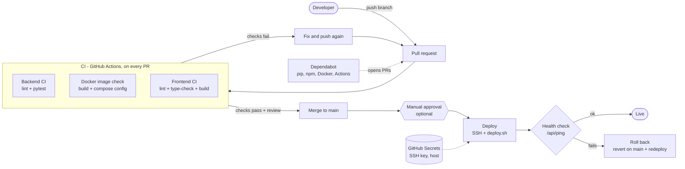

# CI/CD Technology Stack

## CI/CD requirements

The CI/CD pipeline is expected to:

- Run automated checks on every pull request before code reaches `main`.
- Cover the Python backend (FastAPI, Celery workers) and the React PWA frontend.
- Run backend tests and a linter, and build the frontend, so broken changes are caught early.
- Deploy the backend and frontend in a repeatable way, with a quick check that the deployed service is healthy.
- Keep secrets (API keys, database credentials, deployment keys) out of source control.
- Keep document content and other sensitive data out of build and deployment logs.
- Stay simple enough for a small team to understand and maintain.

## Options compared

The options below are compared on cost, ease of use, and team skills, as for the backend stack in [backend.md](backend.md).

### GitHub Actions

- **Cost:** No licence fee. Workflows run on GitHub-hosted runners, and this repository is public, so standard runner minutes are not limited. Private repositories have a monthly free allowance. Hosting for deployment targets is a separate cost.
- **Ease of use:** High. Pipelines are YAML files stored in the repository next to the code, with ready-made actions for checkout, Python and Node setup, caching, and deployment. Secrets, protected environments, and required status checks for pull requests are built into GitHub.
- **Team skills:** The team already uses GitHub for code and pull requests, so no new account or tool is needed. Writing workflows is mostly YAML and shell. *(Confirm the team's prior experience.)*

### GitLab CI/CD

- **Cost:** Free tier available, but it limits CI minutes and requires hosting the project on GitLab or mirroring the GitHub repository to it. Self-hosted runners add infrastructure cost.
- **Ease of use:** High once the project is on GitLab, with a similar YAML model to GitHub Actions. Mirroring or moving the repository adds setup and one more system to maintain.
- **Team skills:** *(Confirm.)* The team works on GitHub today, so this would be a new platform.

### Jenkins

- **Cost:** No licence fee, but it needs a server to host and maintain, plus time for updates, plugins, and security patches.
- **Ease of use:** Low to medium. It is flexible, but requires installing and configuring the server, plugins, agents, and GitHub webhooks before the first pipeline runs.
- **Team skills:** *(Confirm.)* It needs the most operational knowledge of the three options.

### Cost notes

None of the options has a licence fee for this project. The real cost difference is operational: GitHub Actions needs no extra infrastructure, GitLab CI needs a second platform or a mirror, and Jenkins needs a server to run and maintain. Costs of the deployment target (hosting, database, Redis, OCR and AI workloads) are the same whichever CI/CD tool is chosen and depend on decisions still open in [backend.md](backend.md).

## Proposed choice: GitHub Actions

GitHub Actions is recommended for the initial version.

- **Same place as the code:** The repository, pull requests, and reviews are already on GitHub, so CI results appear directly on each pull request.
- **No extra infrastructure:** GitHub-hosted runners remove the need to run and patch a CI server.
- **Fits the backend stack:** Official setup actions for Python and Node, plus dependency caching, cover FastAPI, pytest, and the React/Vite frontend.
- **Secrets and approvals:** GitHub Secrets and protected environments allow a manual approval step before production deployment.
- **Cost:** No licence fee, and no minute limits while the repository is public.

GitLab CI remains a reasonable alternative if the project later moves to GitLab. Jenkins is not recommended for a small team without a strong reason to self-host.

## Proposed pipeline

| Stage | Trigger | What it does | Reason |
|---|---|---|---|
| Backend CI | Pull request, push to `main` | Install dependencies, run a linter (e.g. Ruff) and `pytest` on the supported Python version. | Catch broken changes before merge. |
| Backend image check | Pull request, push to `main` | Build the Docker image and validate the Compose configuration. | Catch deployment configuration errors early. |
| Frontend CI | Pull request, push to `main` | `npm ci`, lint, type-check, and build the React/Vite PWA. | Catch type and build errors. |
| Backend deploy | Push to `main` after CI passes | Connect to the server, run the deployment script, then call a health endpoint. | Repeatable deployment with a basic smoke test. |
| Dependency updates | Scheduled | Dependabot proposes updates for pip, npm, Docker images, and GitHub Actions. | Keep dependencies and base images current. |

Notes:

- Run only one production deployment at a time, so two merges cannot deploy concurrently.
- Use a GitHub environment for production, optionally with manual approval.
- Protect `main` with required status checks and at least one review.
- Tests must not need real documents or a real AI provider. Use fixtures and mocks, so no sensitive data enters CI.

## Prototype reference

The prototype in the [`ProsteFakty/backend`](https://github.com/ProsteFakty/backend) repository (FastAPI, PostgreSQL, Qdrant, Caddy, Docker Compose) is deployed to a single EC2 server by running `deploy.sh` manually. The script pulls the code and restarts or rebuilds only the parts that changed. The proposed deploy stage would call this same script from GitHub Actions over SSH, so the rebuild logic stays in one place. This prototype does not yet match the stack in [backend.md](backend.md) (for example, it has no Celery or Redis), so the pipeline should be updated when the final stack is confirmed.

## Secrets and configuration

| Secret or variable | Where it lives | Purpose |
|---|---|---|
| Server address and SSH user | GitHub Secrets | Reach the deployment server. |
| Deployment SSH key | GitHub Secrets | Used only for deployment, with limited permissions. |
| Application domain | GitHub Variables | Health check after deployment. |
| Database credentials, AI provider keys | Environment file on the server | Not stored in GitHub Actions, so CI cannot read them. |

## Data handling and safety requirements

These requirements apply regardless of the CI/CD tool:

1. **No secrets in source control:** Keep credentials out of the repository, workflow files, and build logs.
2. **No sensitive data in CI:** Do not use real documents, real OCR output, or real AI prompts in tests, and do not log document content in CI or deployment output.
3. **Least privilege:** Give the deployment key and any GitHub tokens only the access they need.
4. **Pin third-party actions:** Pin actions to a version or commit, and let Dependabot update them.
5. **Protect production:** Require passing checks and review on `main`, and keep a documented way to roll back a failed deployment.
6. **Review AI provider terms first:** Do not connect a real AI provider to CI or deployment until its retention and GDPR/RODO terms have been reviewed, as described in [backend.md](backend.md).
